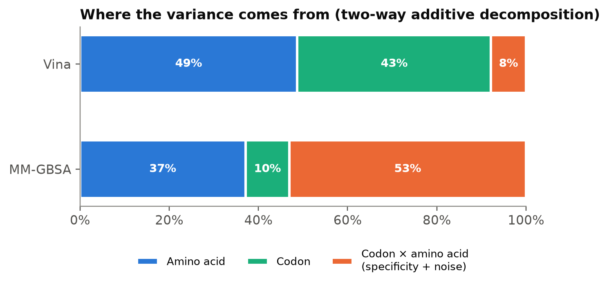
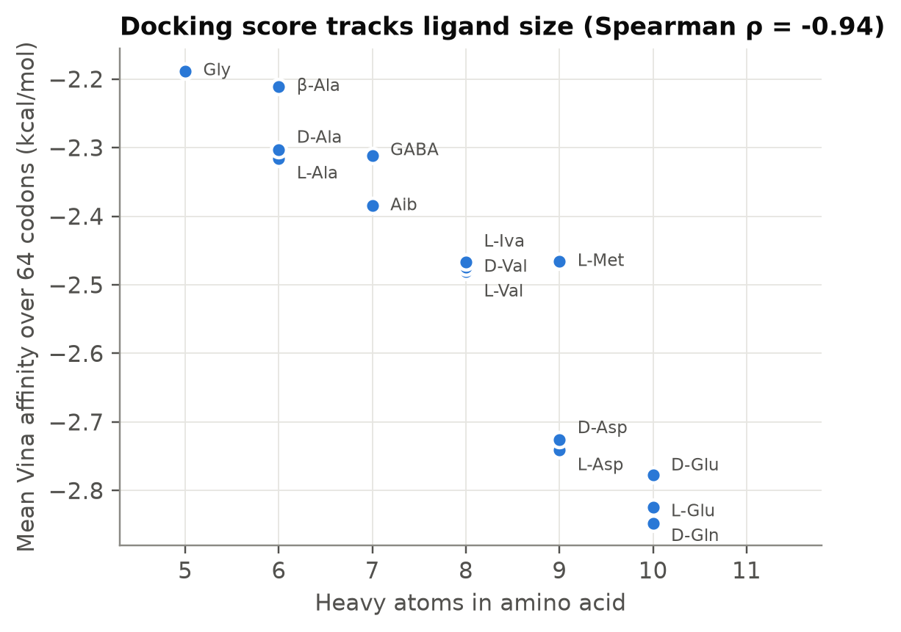
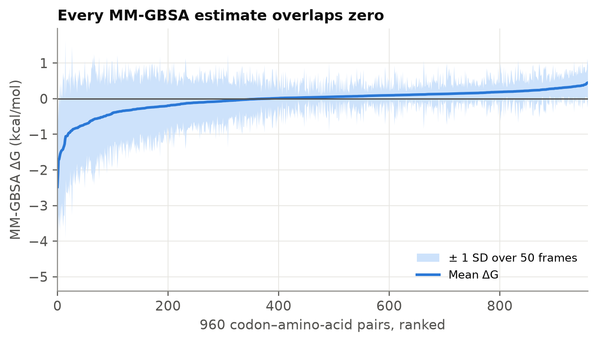
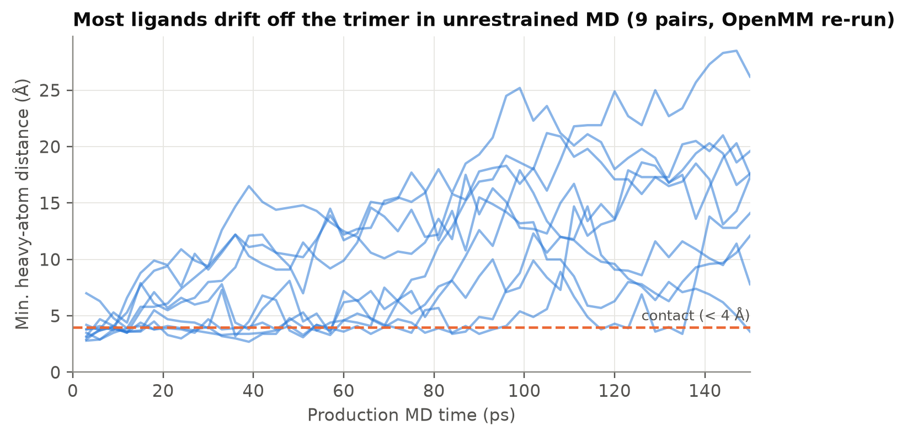

# PNA codon × Bennu amino acid screen

*[Türkçe sürüm → README.tr.md](README.tr.md)*

Could a peptide nucleic acid (PNA) genetic system built from four non-canonical, prebiotically plausible
bases have assigned amino acids to codons by **direct stereochemical recognition**?
This repository screens all **64 three-base PNA codons** against **15 amino acids reported in asteroid Bennu
samples / carbonaceous meteorites** (including D-enantiomers and non-protein amino acids): **960 pairs**,
each docked with AutoDock Vina, simulated with Amber in implicit solvent, and scored by MM-GBSA.

| Code | Base | Amber residue |
|---|---|---|
| **D** | 2,6-diaminopurine | `DAP` |
| **M** | 6-methyluracil | `MTU` |
| **H** | hypoxanthine | `HYX` |
| **U** | uracil | `URA` |

Amino acids: Gly, L-Ala, D-Ala, β-Ala, GABA, Aib (α-aminoisobutyric acid), L-isovaline,
L-Val, D-Val, L-Asp, D-Asp, L-Glu, D-Glu, D-Gln, L-Met.

## Main result (a negative one)

**This model gives no evidence of codon-specific recognition.**

1. **Docking scores are additive and size-driven.** 92 % of the variance in Vina affinity is explained by
   an amino-acid term (49 %) plus a codon term (43 %). The amino-acid term tracks ligand size
   (Spearman ρ = −0.94 with heavy-atom count); the codon term tracks the number of
   2,6-diaminopurine bases (ρ = −0.80). The codon × amino-acid term, which would carry any specificity,
   is 8 % (SD 0.09 kcal/mol), well below Vina's accuracy.
2. **Complexes are not stable in MD.** Every MM-GBSA mean lies within 2 SD of zero
   (range −2.5 to +0.45 kcal/mol; 61 % positive). Independent OpenMM re-runs show the ligand drifting away
   from the trimer within tens of picoseconds, so ΔG mostly measures how long the ligand lingers.
   The top-ranked pairs (UMH–Iva −2.48, MDU–Met −2.14 kcal/mol) gave −0.64 to +0.11 kcal/mol over four
   seeds each.
3. **No chirality preference.** L/D pairs dock alike on every codon. Only Glu/D-Glu differs
   (median 0.05 kcal/mol, p = 0.005), and that difference is far below method accuracy. MM-GBSA shows no
   L/D difference.

**Interpretation.** Free amino acids and single-stranded DMHU-PNA trimers do not form specific complexes
in this model. If such a genetic system existed, codon–amino-acid assignment would more plausibly have
needed adaptor-like intermediates than direct triplet binding. This holds *within the limits listed below*;
"not detected" is not the same as "impossible".

| | |
|---|---|
|  |  |
|  |  |

Full write-up: [docs/report_en.md](docs/report_en.md) · [docs/rapor_tr.md](docs/rapor_tr.md)

## Repository layout

```
data/
  receptors/   {CODON}.prmtop/.inpcrd (tleap)   {codon}_min.pdbqt (minimised, docking receptor)
  ligands/     {aa}.prmtop/.inpcrd/.pdbqt        GAFF2 + AM1-BCC, neutral form
  mdin/        sander inputs: min_complex, md_equil, md_prod, sp_energy
results/
  mmgbsa_results_md.csv     raw screen output, 960 rows
  tables/                   matrices, summaries, variance decomposition, chirality tests, summary_stats.json
docs/                       full report: rapor_tr.md (Türkçe), report_en.md (English)
figures/                    fig1–fig8 (PNG)
scripts/                    01–07, the pipeline in order (see below)
validation/                 independent OpenMM re-runs of selected pairs + plotting script
notebooks/                  original Colab notebook export (provenance)
```

## Pipeline

| Step | Script | What it does |
|---|---|---|
| 1 | `01_parametrize_pna_monomers.sh` | Capped PNA monomers → GAFF2 types, AM1-BCC charges (antechamber, parmchk2) |
| 2 | `02_build_residue_libs.leap` | Remove caps, define head/tail → chainable tleap residues |
| 3 | `03_build_codon_trimers.py` | Build 64 trimers, GB minimisation (sander, igb=5) |
| 4 | `04_parametrize_amino_acids.py` | 15 amino acids → GAFF2/AM1-BCC, prmtop/inpcrd |
| 5 | `05_make_pdbqt.py` | GAFF2→SYBYL retyping, PDBQT with AM1-BCC charges, HD/A atom types |
| 6 | `06_dock_md_mmgbsa.py` | Vina docking → ParmEd complex → min / 100 ps heat / 150 ps MD → MM-GBSA (50 frames) |
| 7 | `07_analyze.py` | Tables, statistics, figures 1–6 |
| — | `validation/rerun_pair_openmm.py` | Same protocol in OpenMM (OBC2, mbondi) to track ligand–trimer distance |

Steps 1–5 are already done: their outputs are in `data/`. The raw monomer (`.cjson`) and amino-acid
(`.sdf`) inputs for steps 1 and 4 belong in `data/raw/`, which is not yet in the repository.

### Reproduce

```bash
conda env create -f environment.yml && conda activate pna-screen
# full screen (CPU, many hours; resumes if interrupted)
python scripts/06_dock_md_mmgbsa.py
# a subset
python scripts/06_dock_md_mmgbsa.py --codons DDD DMH --aas asp gly --out results/test.csv
# analysis and figures (seconds)
python scripts/07_analyze.py
# validation re-run of one pair (~2–5 min on CPU)
python validation/rerun_pair_openmm.py DDD asp 1 > validation/results/seed_DDD_asp_1.json
python validation/plot_validation.py
```

## Known issues and limitations

These do not explain the negative result away (the validation re-runs use a consistent setup and show the
same behaviour), but anyone extending the work should fix them.

- **Receptor geometry mismatch.** Docking uses the minimised trimer (`*_min.pdbqt`), but the complex is
  built on the unminimised tleap coordinates (`{CODON}.inpcrd`). The two differ by 0.4–1.1 Å RMSD.
- **Open trimer termini.** Caps are removed when making residue libraries and no terminal groups are
  added, so the first backbone N and the last carbonyl C have two bonds each.
- **Neutral amino acids.** All ligands are built with net charge 0 (COOH/NH₂), not as the zwitterions
  (or Asp⁻/Glu⁻ anions) present in water near pH 7.
- **GB radii.** Topologies use `mbondi`; `mbondi2` is the recommended set for `igb=5`.
- **Unrestrained, short MD.** 150 ps of free MD on a weak complex lets the ligand leave. Single-trajectory
  MM-GBSA without entropy then reports residence time, not affinity.
- **Model scope.** Single-stranded trimers, implicit solvent, one docked pose per pair, no metal ions or
  mineral surfaces, a general force field (GAFF2) for non-standard PNA residues.

## Suggested next steps

1. Fix the issues above (consistent receptor coordinates, capped termini, zwitterions, mbondi2).
2. Replace free MD with a binding-free-energy method suited to weak binders: restrained MD with
   umbrella sampling or alchemical ΔG, or many short replicas per pair with explicit solvent.
3. Test larger structured contexts (PNA duplexes, hairpins or loops) where binding pockets can form,
   as in RNA aptamer studies of the stereochemical hypothesis.
4. Use docking only as a filter, and control explicitly for ligand size (e.g. ligand efficiency).

## References

- Glavin D. P. *et al.* Abundant ammonia and nitrogen-rich soluble organic matter in samples from asteroid (101955) Bennu. *Nature Astronomy* (2025). doi:10.1038/s41550-024-02472-9
- Yarus M., Widmann J. J., Knight R. RNA–amino acid binding: a stereochemical era for the genetic code. *J. Mol. Evol.* 69, 406–429 (2009). doi:10.1007/s00239-009-9270-1
- Koonin E. V., Novozhilov A. S. Origin and evolution of the genetic code: the universal enigma. *IUBMB Life* 61, 99–111 (2009).
- Nielsen P. E., Egholm M., Berg R. H., Buchardt O. Sequence-selective recognition of DNA by strand displacement with a thymine-substituted polyamide. *Science* 254, 1497–1500 (1991).
- Eberhardt J., Santos-Martins D., Tillack A. F., Forli S. AutoDock Vina 1.2.0. *J. Chem. Inf. Model.* 61, 3891–3898 (2021).
- Onufriev A., Bashford D., Case D. A. Exploring protein native states and large-scale conformational changes with a modified generalized Born model. *Proteins* 55, 383–394 (2004).
- Genheden S., Ryde U. The MM/PBSA and MM/GBSA methods to estimate ligand-binding affinities. *Expert Opin. Drug Discov.* 10, 449–461 (2015).

## Author

Pelinsu Eda Şentürk, Bioengineering, Istanbul Medeniyet University


## License

Code: MIT (see `LICENSE`). Data and figures: CC BY 4.0.
