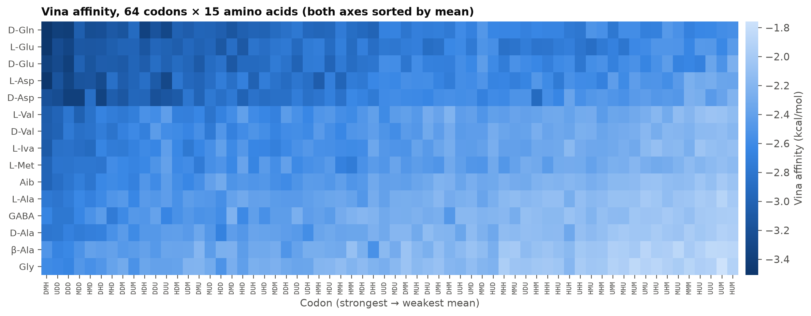
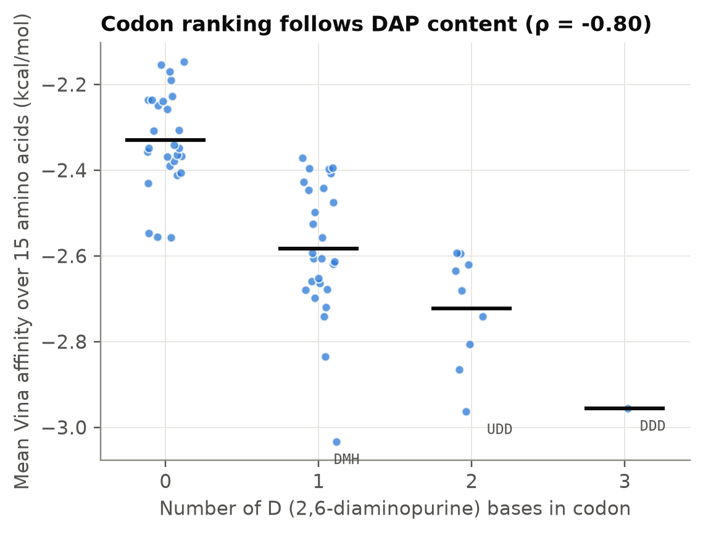
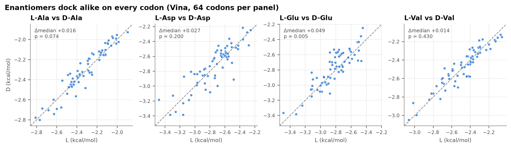
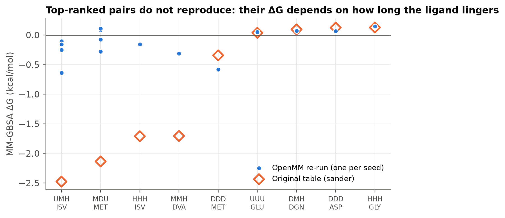

# DMHU-PNA kodonları ile Bennu amino asitleri arasında stereokimyasal tanıma: 960 çiftlik hesaplamalı tarama

Pelinsu Eda Şentürk · Biyomühendislik, İstanbul Medeniyet Üniversitesi · Danışman: Dr. Öğr. Üyesi Saliha Ece Acuner

*[English version → report_en.md](report_en.md)*

## Özet

Bu modelde, serbest amino asitler ile tek iplikli DMHU-PNA kodonları arasında kodona özgü bir tanıma bulunmadı.

**Soru.** Dört kanonik olmayan bazdan kurulan bir peptit nükleik asit (PNA) genetik sistemi, amino asitleri kodonlara doğrudan stereokimyasal etkileşimle atayabilir mi? Kullanılan bazlar 2,6-diaminopürin (D), 6-metilurasil (M), hipoksantin (H) ve urasildir (U).

**Yöntem.** 64 üç-bazlı PNA kodonu, Bennu örneklerinde ve karbonlu göktaşlarında bildirilen 15 amino aside karşı tarandı. Bu amino asitlerin arasında D-enantiyomerler ile Aib, izovalin, β-alanin ve GABA da var. 960 çiftin her biri için sırasıyla şunlar yapıldı: AutoDock Vina ile docking, implicit solventte (GB, igb=5) 100 ps ısıtma ve 150 ps serbest MD, 50 karelik tek-trajektori MM-GBSA. Seçili çiftler OpenMM ile bağımsız olarak yeniden simüle edildi.

**Bulgular.**

1. Vina varyansının %92'si toplamsal: amino asit etkisi %49, kodon etkisi %43. Amino asit etkisi ligand boyutunu izliyor (ρ = −0,94), kodon etkisi DAP sayısını (ρ = −0,80). Kodon × amino asit özgüllüğü %8 düzeyinde ve standart sapması 0,09 kcal/mol.
2. MM-GBSA ortalamalarının hepsi sıfırın 2 SD'si içinde. Ligandlar MD sırasında trimerden ayrılıyor ve en üst sıradaki çiftler tekrarlanmıyor.
3. L/D enantiyomerleri arasında yöntemin doğruluğunu aşan bir fark yok.

**Sonuç.** Bu koşullarda doğrudan üçlü–amino asit tanıması bir kodlama mekanizması olarak desteklenmiyor. Böyle bir sistem var olsaydı, atamanın adaptör benzeri ara moleküllerle kurulmuş olması daha olası.

## Giriş

Genetik kodun kökenine dair stereokimyasal hipotez, ilk kodon atamalarının amino asitlerle nükleotit üçlüleri arasındaki doğrudan kimyasal yakınlıktan doğduğunu öne sürer. RNA aptamer çalışmaları, bazı amino asitlerin bağlanma ceplerinde ilgili kodon ve antikodonların şansın üzerinde sıklıkta görüldüğünü bildirmiştir (Yarus vd., 2009). Hipotez yine de tartışmalıdır ve ortak evrim ya da "donmuş kaza" gibi alternatif açıklamaların doğrudan bir afiniteye ihtiyacı yoktur (Koonin ve Novozhilov, 2009).

PNA, şeker-fosfat omurgası yerine nötr bir N-(2-aminoetil)glisin omurgası taşıyan bir nükleik asit analoğudur (Nielsen vd., 1991). Prebiyotik bir genetik polimer adayı olarak tartışılmaktadır. OSIRIS-REx görevinin getirdiği Bennu örneklerinde, 20 protein amino asidinden 14'ü ve DNA/RNA'nın beş bazı bulundu. Protein dışı kiral amino asitler ise rasemik ya da rasemiğe yakındı (Glavin vd., 2025). Bu, D- ve L-formların prebiyotik ortamda birlikte bulunmuş olabileceğini düşündürüyor.

Bu çalışma şu soruyu sordu: D, M, H ve U bazlarından kurulmuş bir PNA genetik sisteminde, Bennu ile ilişkili amino asitler kodonlarına doğrudan ve özgül biçimde bağlanır mı? Bağlanıyorsa, bu bağlanma enantiyomerleri ayırt eder mi?

## Yöntem

Tüm hesaplamalar AmberTools, Open Babel ve AutoDock Vina ile Google Colab'da yapıldı. Adımların kodu `scripts/` klasöründe.

| Adım | Araç | Ayrıntı |
| --- | --- | --- |
| Monomer parametrizasyonu | antechamber, parmchk2 | Kepli PNA monomerleri; GAFF2 atom tipleri, AM1-BCC yükleri; kepler kaldırılarak tleap rezüdüleri oluşturuldu (DAP, MTU, HYX, URA) |
| Kodon trimerleri | tleap, sander | 4³ = 64 trimer; GB'de (igb=5) 2000 adım minimizasyon |
| Amino asitler | antechamber, tleap | 15 amino asit; GAFF2/AM1-BCC; net yük 0 (nötr COOH/NH₂ formu) |
| Docking | Vina 1.2 (Python) | Minimize trimer = katı reseptör; kutu = reseptörün sınırlayıcı kutusu + 6 Å; exhaustiveness 8; en iyi poz alındı |
| Kompleks | ParmEd | Poz, atom adlarıyla ligand topolojisine aktarıldı; kompleks = reseptör + ligand |
| MD | sander, igb=5, kesme yok | 500 adım minimizasyon (ağır atomlar 5 kcal/mol/Ų ile kısıtlı) → 100 ps ısıtma 0→300 K (2 kcal/mol/Ų) → 150 ps kısıtlamasız MD; Langevin γ = 5 ps⁻¹, 2 fs, SHAKE |
| MM-GBSA | sander tek nokta | Her 3 ps'de bir kare (50 kare): ΔG = E(kompleks) − E(reseptör) − E(ligand); entropi terimi yok |

Analizde 64 × 15'lik Vina ve MM-GBSA matrisleri iki yönlü toplamsal bir modelle ayrıştırıldı: genel ortalama + kodon etkisi + amino asit etkisi + artık. Kodona özgü tanıma olsaydı artık terimde görünmesi gerekirdi. Boyut etkisi, amino asit ortalamaları ile ağır atom sayısı arasındaki Spearman korelasyonuyla test edildi. Kiralite etkisi, dört L/D çifti (Ala, Asp, Glu, Val) için 64 kodon üzerinden eşleştirilmiş Wilcoxon testiyle değerlendirildi; çoklu karşılaştırma için Bonferroni düzeltmesi uygulandı.

## Bulgular

960 çiftin tümü hatasız tamamlandı. Vina afiniteleri −3,51 ile −1,76 kcal/mol arasında (ortalama −2,50). Bu değerler Vina'nın nominal ölçeğinde milimolar düzeyde zayıf bağlanmaya karşılık geliyor. En güçlü skorlar DMH–D-Gln (−3,51), DMH–L-Glu (−3,49) ve DMH–L-Asp (−3,48).

*Şekil 1. 64 kodon × 15 amino asit için Vina afinitesi; iki eksen de ortalamaya göre sıralı. Satır ve sütun desenleri birbirinden bağımsız: her amino asit her kodonda aşağı yukarı aynı sırayı koruyor.*

### Docking skorları toplamsal ve boyut kaynaklı

Vina varyansının %49'u amino asit, %43'ü kodon terimiyle açıklanıyor. Kodona özgü tanımayı taşıması gereken artık terim yalnızca %8 ve standart sapması 0,09 kcal/mol. Bu, Vina'nın birkaç kcal/mol düzeyindeki tipik hatasının çok altında.

*Şekil 2. Vina ve MM-GBSA varyansının iki yönlü toplamsal ayrıştırması.*

Amino asit terimi neredeyse tamamen ligand boyutundan geliyor. Ortalama Vina skoru ile ağır atom sayısı arasında Spearman ρ = −0,94 (p < 10⁻⁶). Kodon terimi ise 2,6-diaminopürin (D) sayısını izliyor (ρ = −0,80). D, dört bazın en büyüğü ve en fazla H-bağı vericisi olanı.

| Amino asit boyutu | Kodondaki D sayısı |
| --- | --- |
|  |  |

*Şekil 3 ve 4. Amino asit başına ortalama Vina skoru ile ağır atom sayısı (sol); kodon başına ortalama Vina skoru ile kodondaki D sayısı (sağ).*

### MM-GBSA bir bağlanma sinyali vermiyor

MM-GBSA ortalamaları −2,48 ile +0,45 kcal/mol arasında; çiftlerin %61'inde ΔG pozitif. 960 çiftin hepsinde |ortalama| < 2 SD. Ortalama ile SD arasında güçlü bir negatif korelasyon var (ρ = −0,69): negatif ΔG'ler yalnızca çok dalgalı simülasyonlardan geliyor. MM-GBSA ile Vina sıralamaları da zayıf ve ters yönde ilişkili (ρ = −0,23). En negatif çiftler UMH–L-Iva (−2,48 ± 2,60), MDU–L-Met (−2,14 ± 1,51) ve HHH–L-Iva (−1,71 ± 1,53).

*Şekil 5. 960 çiftin MM-GBSA ΔG değerleri, sıralanmış; açık mavi bant ± 1 SD.*

### Kiralite tercihi yok

L/D çiftleri 64 kodonun hepsinde birbirine çok yakın skorlar alıyor.

| Çift | Vina, medyan D − L (kcal/mol) | Vina p (Bonferroni) | MM-GBSA, medyan D − L (kcal/mol) | MM-GBSA p (Bonferroni) |
| --- | --- | --- | --- | --- |
| L-Ala / D-Ala | +0,016 | 0,59 | +0,013 | 1,00 |
| L-Asp / D-Asp | +0,027 | 1,00 | −0,006 | 1,00 |
| L-Glu / D-Glu | +0,049 | 0,039 | −0,008 | 1,00 |
| L-Val / D-Val | +0,014 | 1,00 | −0,008 | 1,00 |

Yalnızca Glu/D-Glu çiftinin Vina farkı düzeltme sonrası anlamlı. Bu fark 0,05 kcal/mol, yani yöntemin çözünürlüğünün çok altında ve MM-GBSA'da görünmüyor.

*Şekil 6. L ve D enantiyomerlerinin her kodondaki Vina skorları; kesikli çizgi y = x.*

## Bağımsız doğrulama

OpenMM'de yapılan tekrarlarda ligand, çoğu çiftte ilk birkaç on pikosaniye içinde trimerden ayrılıyor. Bu nedenle MM-GBSA ΔG'si afiniteyi değil, ligandın trimer yakınında ne kadar kaldığını ölçüyor.

Tarama protokolü OpenMM 8.6 ile birebir yeniden kuruldu: OBC2 (igb=5'in karşılığı), mbondi yarıçapları, kesme yok, aynı kısıtlama, ısıtma ve üretim süreleri. Başlangıç pozu için Vina yerine GB etkileşim enerjisi üzerinden rastgele katı cisim araması kullanıldı. 9 çift seçildi: en negatif MM-GBSA'ya sahip dört çift, en güçlü Vina skoru (DMH–D-Gln) ve sıfıra yakın dört çift (DDD–L-Asp, DDD–L-Met, HHH–Gly, UUU–L-Glu). En üstteki iki çift dörder farklı tohumla tekrarlandı. Kod ve sonuçlar `validation/` klasöründe.

*Şekil 7. Üretim MD'si boyunca ligand ile trimer arasındaki minimum ağır atom mesafesi (9 çift). Kesikli çizgi 4 Å temas eşiği.*

Karelerin temas halinde olduğu oran %2 ile %56 arasında değişiyor. MD başlarken ligand trimerle temas halinde ve etkileşim enerjisi −1,2 ile −3,9 kcal/mol arasında; bu temas kısıtlama kalktıktan sonra korunmuyor. Sıfıra yakın çiftlerde tekrar sonuçları orijinal tabloyla uyumlu. Örneğin DDD–L-Asp orijinalde 0,12 ± 0,27, tekrarda 0,06 ± 0,13 kcal/mol.

*Şekil 8. Orijinal tablo değerleri (boş eşkenar dörtgen) ile OpenMM tekrarları (mavi nokta, her tohum için bir nokta).*

| Çift | Orijinal ΔG (kcal/mol) | Tekrarlar ΔG (kcal/mol) | Temas oranı |
| --- | --- | --- | --- |
| UMH–L-Iva | −2,48 ± 2,60 | −0,64; −0,10; −0,15; −0,25 | %8–30 |
| MDU–L-Met | −2,14 ± 1,51 | +0,09; +0,11; −0,28; −0,08 | %4–38 |
| HHH–L-Iva | −1,71 ± 1,53 | −0,16 | %36 |
| MMH–D-Val | −1,71 ± 1,72 | −0,31 | %20 |
| DDD–L-Met | −0,34 ± 0,86 | −0,58 | %56 |

Tablonun en üstündeki değerler tekrarlanmıyor. 960 gürültülü tahmin arasından en uçları seçildiğinde beklenen budur: ortalamaya geri dönüş. Bu çiftlerin öne çıkması, ligandın tesadüfen daha uzun süre temas halinde kalmasından kaynaklanıyor. Hidrofobik ligandların (Iva, Met, Val) listede sık görünmesi de buna bağlanabilir: van der Waals teması yapışkanlığı biraz artırıyor ama özgül bir bağlanma sağlamıyor.

## Tartışma ve sınırlar

Sonuçlar, serbest bir amino asit ile tek iplikli bir PNA üçlüsü arasındaki etkileşimin hem zayıf hem de özgül olmadığını gösteriyor. Docking skorunu belirleyen şey, "bu kodon bu amino asidi tanıyor" değil, "büyük ligand büyük yüzeye daha çok değiyor". Bu da Vina'nın bilinen boyut yanlılığıyla uyumlu. RNA aptamer çalışmalarında amino asit seçiciliği katlanmış, çok daha büyük yapıların ceplerinde görülüyor (Yarus vd., 2009). Çıplak üçlülerde bir sinyal bulunmaması bu tabloyla çelişmiyor.

Bu negatif sonuç aşağıdaki sınırlar içinde geçerli. "Tespit edilmedi" ile "mümkün değil" aynı şey değil.

- **Reseptör geometrisi.** Docking minimize trimerle yapıldı, kompleks ise minimize edilmemiş tleap koordinatlarıyla kuruldu. İkisi arasındaki RMSD 0,4–1,1 Å.
- **Açık trimer uçları.** Kepler kaldırıldıktan sonra uç grup eklenmedi; ilk omurga N'si ve son karbonil C'si ikişer bağlı.
- **Nötr amino asitler.** Ligandlar pH 7'deki zwitteriyon ve anyon formlarında değil, nötr formda modellendi. Bu, elektrostatik etkileşimleri değiştirebilir.
- **GB yarıçapları.** igb=5 için önerilen mbondi2 yerine mbondi kullanıldı.
- **Kısa ve kısıtlamasız MD.** Zayıf kompleks 150 ps'de dağılıyor. Entropisiz tek-trajektori MM-GBSA bu durumda bağlanma serbest enerjisini ölçmüyor.
- **Modelin kapsamı.** Tek iplikli trimer, implicit solvent, çift başına tek poz, iyon ya da mineral yüzey yok, standart dışı PNA rezüdüleri için genel bir kuvvet alanı (GAFF2).

Doğrulama tekrarlarında ilk iki sorun yok: reseptör koordinatları tutarlı ve başlangıç pozu aynı geometriye göre aranıyor. Davranış yine de aynı çıkıyor. Bu yüzden bu sorunların ana sonucu değiştirmesi beklenmiyor. Zwitteriyon formların etkisi ise test edilmedi.

## Sonuç ve sonraki adımlar

Bu modelde Bennu ile ilişkili amino asitlerin DMHU-PNA kodonlarına doğrudan, özgül ya da kiraliteye duyarlı biçimde bağlandığına dair bir kanıt bulunmadı. Böyle bir genetik sistem var olsaydı, kodon–amino asit atamasının doğrudan üçlü bağlanmasından çok adaptör benzeri ara moleküllerle kurulmuş olması daha olası. Çalışma ayrıca yüksek verimli docking + MM-GBSA taramalarında iki tuzağı somut olarak gösteriyor: ligand boyutu yanlılığı ve kararlı olmayan komplekslerde ΔG'nin kalış süresini ölçmesi.

1. **Teknik düzeltmeler.** Tutarlı reseptör koordinatları, kepli trimer uçları, zwitteriyon formlar ve mbondi2.
2. **Uygun serbest enerji yöntemi.** Zayıf bağlayıcılar için kısıtlı MD ile umbrella sampling ya da alkimyasal ΔG; veya explicit solventte çift başına çok sayıda kısa replika.
3. **Daha büyük yapılar.** Bağlanma ceplerinin oluşabileceği PNA dupleksleri, saç tokaları ve halkalar.
4. **Boyut kontrolü.** Docking'i yalnızca filtre olarak kullanmak ve ligand verimliliği gibi boyuttan arındırılmış ölçüler eklemek.

## Kaynaklar

1. Glavin D. P. vd. Abundant ammonia and nitrogen-rich soluble organic matter in samples from asteroid (101955) Bennu. *Nature Astronomy* (2025). [doi:10.1038/s41550-024-02472-9](https://doi.org/10.1038/s41550-024-02472-9)
2. Yarus M., Widmann J. J., Knight R. RNA–amino acid binding: a stereochemical era for the genetic code. *J. Mol. Evol.* 69, 406–429 (2009). [doi:10.1007/s00239-009-9270-1](https://doi.org/10.1007/s00239-009-9270-1)
3. Koonin E. V., Novozhilov A. S. Origin and evolution of the genetic code: the universal enigma. *IUBMB Life* 61, 99–111 (2009). [arXiv:0807.4749](https://arxiv.org/abs/0807.4749)
4. Nielsen P. E., Egholm M., Berg R. H., Buchardt O. Sequence-selective recognition of DNA by strand displacement with a thymine-substituted polyamide. *Science* 254, 1497–1500 (1991).
5. Eberhardt J., Santos-Martins D., Tillack A. F., Forli S. AutoDock Vina 1.2.0. *J. Chem. Inf. Model.* 61, 3891–3898 (2021).
6. Onufriev A., Bashford D., Case D. A. Exploring protein native states and large-scale conformational changes with a modified generalized Born model. *Proteins* 55, 383–394 (2004).
7. Genheden S., Ryde U. The MM/PBSA and MM/GBSA methods to estimate ligand-binding affinities. *Expert Opin. Drug Discov.* 10, 449–461 (2015).
